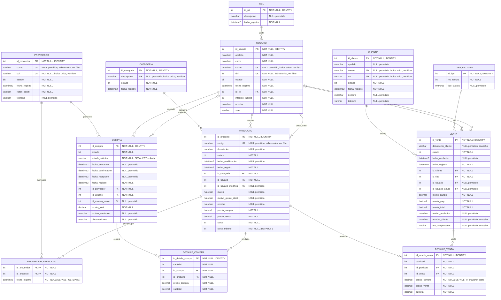

# Diagrama Entidad-Relación y Diccionario de Datos
**SistemaVentaStock — Taller de Programación II — Grupo 70**

## 1. Alcance del modelo de datos

Este documento describe el esquema relacional de la base de datos `DB_SISTEMA_VENTA` definido a través de las diez migraciones de Entity Framework Core del proyecto (hasta `20261116193554_AddVistasReportes`).

- **Fuente del modelo**: `CapaDatos/AppDbContext.cs`, `CapaDatos/Migrations/AppDbContextModelSnapshot.cs` y las migraciones ubicadas en `CapaDatos/Migrations/`.
- **Objetos de motor incluidos**: Tablas, claves primarias y foráneas, índices únicos filtrados, restricciones `CHECK`, el trigger de auditoría de productos (`TR_PRODUCTO_FECHA_MODIFICACION`), el tipo de tabla `dbo.TipoDetalleVenta`, el procedimiento almacenado transaccional `dbo.sp_RegistrarVenta` y las vistas de reportes `dbo.vw_ResumenDiarioVentas` y `dbo.vw_ParticipacionCategorias`.

## 2. Diagrama del esquema existente

El diagrama representa las claves foráneas existentes. `||` indica una referencia obligatoria y `|o` una referencia opcional. El lado dependiente usa `o{`: una clave foránea no obliga a una cabecera a tener al menos un detalle. Los tipos exactos, longitudes y restricciones se detallan en el diccionario.

## 3. Diccionario de columnas

`Nulo = Sí` significa que la base admite `NULL`, aunque la interfaz pueda exigir el dato. Todas las claves primarias son `INT IDENTITY(1,1)`. Los valores iniciales de propiedades C# no se presentan como defaults SQL. No hay columnas calculadas en este esquema.

### 3.1. `ROL`

| Columna | Tipo SQL Server | Nulo | Definición |
| --- | --- | :---: | --- |
| `id_rol` | `INT` | No | Clave primaria; `IDENTITY(1,1)` |
| `descripcion` | `NVARCHAR(MAX)` | Sí | Columna almacenada. |
| `fecha_registro` | `DATETIME2` | No | Columna almacenada. |

### 3.2. `USUARIO`

| Columna | Tipo SQL Server | Nulo | Definición |
| --- | --- | :---: | --- |
| `id_usuario` | `INT` | No | Clave primaria; `IDENTITY(1,1)` |
| `apellido` | `NVARCHAR(MAX)` | No | Default declarado en migración: `N''` |
| `clave` | `NVARCHAR(MAX)` | No | Default declarado en migración: `N''` |
| `correo` | `NVARCHAR(450)` | Sí | Índice único `IX_USUARIO_correo`; filtro en §4 |
| `dni` | `INT` | No | Índice único `IX_USUARIO_dni`; filtro en §4 |
| `estado` | `BIT` | No | Valor `BIT`; la columna por sí sola no impide borrados físicos |
| `fecha_registro` | `DATETIME2` | No | Columna almacenada. |
| `id_rol` | `INT` | No | FK a `ROL.id_rol`; `CASCADE` |
| `intentos_fallidos` | `INT` | No | Contador persistido; no existe CHECK de límite de intentos |
| `nombre` | `NVARCHAR(MAX)` | No | Default declarado en migración: `N''` |
| `sexo` | `VARCHAR(1)` | No | Columna almacenada. |

### 3.3. `CATEGORIA`

| Columna | Tipo SQL Server | Nulo | Definición |
| --- | --- | :---: | --- |
| `id_categoria` | `INT` | No | Clave primaria; `IDENTITY(1,1)` |
| `descripcion` | `NVARCHAR(100)` | Sí | Índice único `IX_CATEGORIA_descripcion`; filtro en §4 |
| `estado` | `BIT` | No | Valor `BIT`; la columna por sí sola no impide borrados físicos |
| `fecha_registro` | `DATETIME2` | No | Columna almacenada. |

### 3.4. `PRODUCTO`

| Columna | Tipo SQL Server | Nulo | Definición |
| --- | --- | :---: | --- |
| `id_producto` | `INT` | No | Clave primaria; `IDENTITY(1,1)` |
| `codigo` | `NVARCHAR(13)` | Sí | Índice único `IX_PRODUCTO_codigo`; filtro en §4; Código de producto; no existe CHECK SQL de formato numérico |
| `descripcion` | `NVARCHAR(300)` | Sí | Columna almacenada. |
| `estado` | `BIT` | No | Valor `BIT`; la columna por sí sola no impide borrados físicos |
| `fecha_modificacion` | `DATETIME2` | Sí | Actualizada por trigger `TR_PRODUCTO_FECHA_MODIFICACION`; no es columna calculada |
| `fecha_registro` | `DATETIME2` | No | Default declarado en migración: `GETDATE()` |
| `id_categoria` | `INT` | No | FK a `CATEGORIA.id_categoria`; `RESTRICT` |
| `id_usuario` | `INT` | No | FK a `USUARIO.id_usuario`; `RESTRICT` |
| `id_usuario_modifica` | `INT` | Sí | FK a `USUARIO.id_usuario`; `RESTRICT` |
| `marca` | `NVARCHAR(100)` | Sí | Marca comercial del producto |
| `motivo_ajuste_stock` | `NVARCHAR(300)` | Sí | Columna almacenada. |
| `nombre` | `NVARCHAR(100)` | Sí | Columna almacenada. |
| `precio_compra` | `DECIMAL(18,2)` | No | Columna almacenada. |
| `precio_venta` | `DECIMAL(18,2)` | No | Columna almacenada. |
| `stock` | `INT` | No | Columna almacenada. |
| `stock_minimo` | `INT` | No | Umbral de reposición propio del producto (`DEFAULT 5`) |

### 3.5. `CLIENTE`

| Columna | Tipo SQL Server | Nulo | Definición |
| --- | --- | :---: | --- |
| `id_cliente` | `INT` | No | Clave primaria; `IDENTITY(1,1)` |
| `apellido` | `NVARCHAR(100)` | Sí | Columna almacenada. |
| `correo` | `NVARCHAR(254)` | Sí | Índice único `IX_CLIENTE_correo`; filtro en §4 |
| `dni` | `VARCHAR(20)` | Sí | Índice único `IX_CLIENTE_dni`; filtro en §4 |
| `estado` | `BIT` | No | Valor `BIT`; la columna por sí sola no impide borrados físicos |
| `fecha_registro` | `DATETIME2` | No | Columna almacenada. |
| `nombre` | `NVARCHAR(100)` | Sí | Columna almacenada. |
| `telefono` | `VARCHAR(15)` | Sí | Columna almacenada. |

### 3.6. `PROVEEDOR`

| Columna | Tipo SQL Server | Nulo | Definición |
| --- | --- | :---: | --- |
| `id_proveedor` | `INT` | No | Clave primaria; `IDENTITY(1,1)` |
| `correo` | `VARCHAR(254)` | Sí | Índice único `IX_PROVEEDOR_correo`; filtro en §4 |
| `cuit` | `VARCHAR(13)` | No | Índice único `IX_PROVEEDOR_cuit`; filtro en §4; Default declarado en migración: `''` |
| `estado` | `BIT` | No | Valor `BIT`; la columna por sí sola no impide borrados físicos |
| `fecha_registro` | `DATETIME2` | No | Columna almacenada. |
| `razon_social` | `VARCHAR(200)` | No | Default declarado en migración: `''` |
| `telefono` | `VARCHAR(15)` | Sí | Columna almacenada. |

### 3.7. `TIPO_FACTURA`

| Columna | Tipo SQL Server | Nulo | Definición |
| --- | --- | :---: | --- |
| `id_tipo` | `INT` | No | Clave primaria; `IDENTITY(1,1)` |
| `nro_factura` | `INT` | No | Entero almacenado; no es IDENTITY ni columna de la tabla VENTA |
| `tipo_factura` | `NVARCHAR(MAX)` | Sí | Columna almacenada. |

### 3.8. `COMPRA`

| Columna | Tipo SQL Server | Nulo | Definición |
| --- | --- | :---: | --- |
| `id_compra` | `INT` | No | Clave primaria; `IDENTITY(1,1)` |
| `estado` | `BIT` | No | Estado lógico (`1` = activa, `0` = anulada) |
| `estado_solicitud` | `VARCHAR(20)` | No | Estado del ciclo de compra (`'Pendiente'`, `'Confirmada'`, `'Recibida'`, `'Anulada'`); `DEFAULT 'Recibida'` |
| `fecha_anulacion` | `DATETIME2` | Sí | Fecha y hora de anulación de la compra |
| `fecha_confirmacion` | `DATETIME2` | Sí | Fecha y hora de confirmación por parte del proveedor |
| `fecha_recepcion` | `DATETIME2` | Sí | Fecha y hora de recepción física de la mercadería |
| `fecha_registro` | `DATETIME2` | No | Fecha y hora de creación de la solicitud/compra |
| `id_proveedor` | `INT` | No | FK a `PROVEEDOR.id_proveedor`; `CASCADE` |
| `id_usuario` | `INT` | No | FK a `USUARIO.id_usuario`; `CASCADE` |
| `id_usuario_anula` | `INT` | Sí | FK a `USUARIO.id_usuario`; `RESTRICT` |
| `monto_total` | `DECIMAL(18,2)` | No | Importe total de la compra |
| `motivo_anulacion` | `NVARCHAR(300)` | Sí | Motivo de anulación informado por el encargado |
| `observaciones` | `NVARCHAR(300)` | Sí | Observaciones de la solicitud enviada al proveedor |

### 3.9. `DETALLE_COMPRA`

| Columna | Tipo SQL Server | Nulo | Definición |
| --- | --- | :---: | --- |
| `id_detalle_compra` | `INT` | No | Clave primaria; `IDENTITY(1,1)` |
| `cantidad` | `INT` | No | Columna almacenada. |
| `id_compra` | `INT` | No | FK a `COMPRA.id_compra`; `CASCADE` |
| `id_producto` | `INT` | No | FK a `PRODUCTO.id_producto`; `CASCADE` |
| `precio_compra` | `DECIMAL(18,2)` | No | Columna almacenada. |
| `subtotal` | `DECIMAL(18,2)` | No | Importe almacenado; no calculado ni validado mediante CHECK |

### 3.10. `VENTA`

| Columna | Tipo SQL Server | Nulo | Definición |
| --- | --- | :---: | --- |
| `id_venta` | `INT` | No | Clave primaria; `IDENTITY(1,1)` |
| `documento_cliente` | `VARCHAR(20)` | Sí | Snapshot del documento del cliente al momento de emitir la venta |
| `estado` | `BIT` | No | Estado lógico del comprobante (`1` = activa, `0` = anulada) |
| `fecha_anulacion` | `DATETIME2` | Sí | Fecha y hora de anulación de la venta |
| `fecha_registro` | `DATETIME2` | No | Fecha y hora de emisión de la venta |
| `id_cliente` | `INT` | No | FK a `CLIENTE.id_cliente`; `CASCADE` |
| `id_tipo` | `INT` | No | FK a `TIPO_FACTURA.id_tipo`; `CASCADE` |
| `id_usuario` | `INT` | Sí | FK a `USUARIO.id_usuario` (cajero que operó la venta); `RESTRICT` |
| `id_usuario_anula` | `INT` | Sí | FK a `USUARIO.id_usuario` (encargado que anuló la venta); `RESTRICT` |
| `monto_cambio` | `DECIMAL(18,2)` | No | Vuelto calculado para la operación |
| `monto_pago` | `DECIMAL(18,2)` | No | Importe abonado por el cliente |
| `monto_total` | `DECIMAL(18,2)` | No | Importe total de la venta |
| `motivo_anulacion` | `NVARCHAR(300)` | Sí | Motivo de anulación informado por el encargado |
| `nombre_cliente` | `NVARCHAR(200)` | Sí | Snapshot del nombre completo del cliente al momento de emitir la venta |
| `nro_comprobante` | `VARCHAR(20)` | Sí | Snapshot del número de comprobante emitido (ej. `B-00000001`) |

### 3.11. `DETALLE_VENTA`

| Columna | Tipo SQL Server | Nulo | Definición |
| --- | --- | :---: | --- |
| `id_detalle_venta` | `INT` | No | Clave primaria; `IDENTITY(1,1)` |
| `cantidad` | `INT` | No | Columna almacenada. |
| `id_producto` | `INT` | No | FK a `PRODUCTO.id_producto`; `CASCADE` |
| `id_venta` | `INT` | No | FK a `VENTA.id_venta`; `CASCADE` |
| `precio_compra` | `DECIMAL(18,2)` | No | Snapshot del costo unitario del producto al momento de la venta (`DEFAULT 0`) |
| `precio_venta` | `DECIMAL(18,2)` | No | Columna almacenada. |
| `subtotal` | `DECIMAL(18,2)` | No | Importe almacenado; no calculado ni validado mediante CHECK |

### 3.12. `PROVEEDOR_PRODUCTO`

| Columna | Tipo SQL Server | Nulo | Definición |
| --- | --- | :---: | --- |
| `id_proveedor` | `INT` | No | Parte de la clave primaria compuesta; FK a `PROVEEDOR.id_proveedor`; `CASCADE` |
| `id_producto` | `INT` | No | Parte de la clave primaria compuesta; FK a `PRODUCTO.id_producto`; `CASCADE` |
| `fecha_registro` | `DATETIME2` | No | Fecha de vinculación (`DEFAULT GETDATE()`) |

## 4. Índices existentes

Se enumeran los índices adicionales a las claves primarias. Los índices filtrados solo restringen las filas que cumplen el filtro; no convierten la columna en obligatoria.

| Tabla | Índice | Columnas | Único | Filtro |
| --- | --- | --- | :---: | --- |
| `USUARIO` | `IX_USUARIO_correo` | `correo` | Sí | `[correo] IS NOT NULL` |
| `USUARIO` | `IX_USUARIO_dni` | `dni` | Sí | Sin filtro |
| `USUARIO` | `IX_USUARIO_id_rol` | `id_rol` | No | Sin filtro |
| `CATEGORIA` | `IX_CATEGORIA_descripcion` | `descripcion` | Sí | `[descripcion] IS NOT NULL` |
| `PRODUCTO` | `IX_PRODUCTO_codigo` | `codigo` | Sí | `[codigo] IS NOT NULL` |
| `PRODUCTO` | `IX_PRODUCTO_id_categoria` | `id_categoria` | No | Sin filtro |
| `PRODUCTO` | `IX_PRODUCTO_id_usuario` | `id_usuario` | No | Sin filtro |
| `PRODUCTO` | `IX_PRODUCTO_id_usuario_modifica` | `id_usuario_modifica` | No | Sin filtro |
| `CLIENTE` | `IX_CLIENTE_correo` | `correo` | Sí | `[correo] IS NOT NULL AND [correo] <> ''` |
| `CLIENTE` | `IX_CLIENTE_dni` | `dni` | Sí | `[dni] IS NOT NULL` |
| `PROVEEDOR` | `IX_PROVEEDOR_correo` | `correo` | Sí | `[correo] IS NOT NULL AND [correo] <> ''` |
| `PROVEEDOR` | `IX_PROVEEDOR_cuit` | `cuit` | Sí | `[cuit] IS NOT NULL` |
| `COMPRA` | `IX_COMPRA_id_proveedor` | `id_proveedor` | No | Sin filtro |
| `COMPRA` | `IX_COMPRA_id_usuario` | `id_usuario` | No | Sin filtro |
| `COMPRA` | `IX_COMPRA_id_usuario_anula` | `id_usuario_anula` | No | Sin filtro |
| `PROVEEDOR_PRODUCTO` | `IX_PROVEEDOR_PRODUCTO_id_producto` | `id_producto` | No | Sin filtro |
| `DETALLE_COMPRA` | `IX_DETALLE_COMPRA_id_compra` | `id_compra` | No | Sin filtro |
| `DETALLE_COMPRA` | `IX_DETALLE_COMPRA_id_producto` | `id_producto` | No | Sin filtro |
| `VENTA` | `IX_VENTA_id_cliente` | `id_cliente` | No | Sin filtro |
| `VENTA` | `IX_VENTA_id_tipo` | `id_tipo` | No | Sin filtro |
| `VENTA` | `IX_VENTA_id_usuario` | `id_usuario` | No | Sin filtro |
| `VENTA` | `IX_VENTA_id_usuario_anula` | `id_usuario_anula` | No | Sin filtro |
| `DETALLE_VENTA` | `IX_DETALLE_VENTA_id_producto` | `id_producto` | No | Sin filtro |
| `DETALLE_VENTA` | `IX_DETALLE_VENTA_id_venta` | `id_venta` | No | Sin filtro |

## 5. Integridad referencial y borrado

| Restricción | Columna dependiente | Referencia | ON DELETE |
| --- | --- | --- | --- |
| `FK_USUARIO_ROL_id_rol` | `USUARIO.id_rol` | `ROL.id_rol` | `CASCADE` |
| `FK_PRODUCTO_CATEGORIA_id_categoria` | `PRODUCTO.id_categoria` | `CATEGORIA.id_categoria` | `RESTRICT` |
| `FK_PRODUCTO_USUARIO_id_usuario` | `PRODUCTO.id_usuario` | `USUARIO.id_usuario` | `RESTRICT` |
| `FK_PRODUCTO_USUARIO_id_usuario_modifica` | `PRODUCTO.id_usuario_modifica` | `USUARIO.id_usuario` | `RESTRICT` |
| `FK_PROVEEDOR_PRODUCTO_PROVEEDOR_id_proveedor` | `PROVEEDOR_PRODUCTO.id_proveedor` | `PROVEEDOR.id_proveedor` | `CASCADE` |
| `FK_PROVEEDOR_PRODUCTO_PRODUCTO_id_producto` | `PROVEEDOR_PRODUCTO.id_producto` | `PRODUCTO.id_producto` | `CASCADE` |
| `FK_COMPRA_PROVEEDOR_id_proveedor` | `COMPRA.id_proveedor` | `PROVEEDOR.id_proveedor` | `CASCADE` |
| `FK_COMPRA_USUARIO_id_usuario` | `COMPRA.id_usuario` | `USUARIO.id_usuario` | `CASCADE` |
| `FK_COMPRA_USUARIO_id_usuario_anula` | `COMPRA.id_usuario_anula` | `USUARIO.id_usuario` | `RESTRICT` |
| `FK_DETALLE_COMPRA_COMPRA_id_compra` | `DETALLE_COMPRA.id_compra` | `COMPRA.id_compra` | `CASCADE` |
| `FK_DETALLE_COMPRA_PRODUCTO_id_producto` | `DETALLE_COMPRA.id_producto` | `PRODUCTO.id_producto` | `CASCADE` |
| `FK_VENTA_CLIENTE_id_cliente` | `VENTA.id_cliente` | `CLIENTE.id_cliente` | `CASCADE` |
| `FK_VENTA_TIPO_FACTURA_id_tipo` | `VENTA.id_tipo` | `TIPO_FACTURA.id_tipo` | `CASCADE` |
| `FK_VENTA_USUARIO_id_usuario` | `VENTA.id_usuario` | `USUARIO.id_usuario` | `RESTRICT` |
| `FK_VENTA_USUARIO_id_usuario_anula` | `VENTA.id_usuario_anula` | `USUARIO.id_usuario` | `RESTRICT` |
| `FK_DETALLE_VENTA_PRODUCTO_id_producto` | `DETALLE_VENTA.id_producto` | `PRODUCTO.id_producto` | `CASCADE` |
| `FK_DETALLE_VENTA_VENTA_id_venta` | `DETALLE_VENTA.id_venta` | `VENTA.id_venta` | `CASCADE` |

`RESTRICT` es el comportamiento declarado por EF para las relaciones de PRODUCTO; SQL Server lo materializa sin borrado en cascada (`NO ACTION`). Las demás relaciones enumeradas mantienen `CASCADE` porque así están definidas en esta referencia. Una cadena de cascadas puede detenerse ante otra FK restrictiva. La política de bajas lógicas de la aplicación no equivale a una prohibición física de `DELETE` en la base.

## 6. Defaults, restricciones CHECK y objetos programables

### 6.1. Defaults declarados por las migraciones

- `USUARIO.nombre`, `USUARIO.apellido` y `USUARIO.clave`: cadena vacía (`N''`) en `20260916031358_AddUserConstraints`.
- `PROVEEDOR.razon_social` y `PROVEEDOR.cuit`: cadena vacía (`''`) en `20261029005147_AddProveedorConstraints`.
- `PRODUCTO.fecha_registro`: `GETDATE()` en `20261023044204_AddProductConstraints`.

### 6.2. Restricción CHECK existente

- `CK_USUARIO_SEXO` en `USUARIO`: `[sexo] IN ('M', 'F')`.
- Las validaciones de stock no negativo, cantidades positivas, precios, subtotales y vuelto se aplican en la capa de negocio y en el procedimiento almacenado de ventas.

### 6.3. Trigger de PRODUCTO

`dbo.TR_PRODUCTO_FECHA_MODIFICACION`, creado en `20261023044204_AddProductConstraints`, se ejecuta `AFTER UPDATE` sobre `PRODUCTO` y actualiza `fecha_modificacion = GETDATE()` para las filas afectadas utilizando la tabla lógica `inserted`.

### 6.4. Tipo de tabla y procedimiento almacenado de ventas

Incorporados en la migración `20261111223022_AddSpRegistrarVenta` (y en `scripts/sp_RegistrarVenta.sql`):

- **`dbo.TipoDetalleVenta`**: Tipo de tabla definido por el usuario (`IdProducto INT NOT NULL`, `Cantidad INT NOT NULL`, `PrecioVenta DECIMAL(18,2) NOT NULL`, `Subtotal DECIMAL(18,2) NOT NULL`) utilizado como parámetro `READONLY` (TVP) para enviar las líneas del carrito en un único viaje al motor.
- **`dbo.sp_RegistrarVenta`**: Procedimiento almacenado que ejecuta el cobro y registro de la venta bajo una transacción explícita (`SET XACT_ABORT ON`, `BEGIN TRANSACTION`):
  - Resuelve el cliente seleccionado o asigna por defecto *Consumidor Final* (`dni = '0'`).
  - Verifica productos activos y bloquea las filas involucradas en `PRODUCTO` mediante `WITH (UPDLOCK, HOLDLOCK)` para validar y descontar existencias sin condiciones de carrera.
  - Inserta la cabecera en `VENTA` persistiendo los snapshots `documento_cliente` y `nombre_cliente`.
  - Inserta los renglones en `DETALLE_VENTA` e incrementa el contador `nro_factura` en `TIPO_FACTURA`.
  - Confirma con `COMMIT TRANSACTION` o revierte con `ROLLBACK TRANSACTION` ante cualquier error, devolviendo el resultado por parámetros `OUTPUT` (`@IdVentaGenerada`, `@CodigoResultado`, `@MensajeResultado`).

### 6.5. Vistas de reportes

La migración `20261116193554_AddVistasReportes` incorpora dos vistas mediante `CREATE OR ALTER VIEW`. Ambas consultan únicamente ventas activas (`VENTA.estado = 1`):

| Vista | Fuentes y agrupación | Columnas expuestas |
| --- | --- | --- |
| `dbo.vw_ResumenDiarioVentas` | `VENTA` y `DETALLE_VENTA`, agrupadas por la fecha de registro de la venta | `fecha`, `comprobantes_emitidos`, `total_ventas`, `ganancia_total`, `ticket_promedio` |
| `dbo.vw_ParticipacionCategorias` | `DETALLE_VENTA`, `VENTA`, `PRODUCTO` y `CATEGORIA`, agrupadas por identificador y descripción de categoría | `id_categoria`, `categoria`, `total_transacciones`, `unidades_vendidas`, `monto_total` |

Son objetos de consulta, no tablas adicionales ni nuevas relaciones del diagrama. La ganancia diaria utiliza el costo histórico almacenado en `DETALLE_VENTA.precio_compra`. La operación `Down` de la migración elimina ambas vistas mediante `DROP VIEW IF EXISTS`.

## 7. Notas sobre el diseño actual

- **Detalle de compras**: `DETALLE_COMPRA` almacena `precio_compra`, `cantidad` y `subtotal`. La recepción de mercadería actualiza `PRODUCTO.stock` y `PRODUCTO.precio_compra`, pero no modifica `PRODUCTO.precio_venta`; el precio de venta se gestiona de forma independiente desde el catálogo de Productos.
- **Inmutabilidad de datos del cliente en ventas**: `VENTA` conserva tanto la clave foránea `id_cliente` como los snapshots `documento_cliente` y `nombre_cliente` para preservar los datos vigentes al momento de la facturación.
- **Numeración de comprobantes**: `TIPO_FACTURA.nro_factura` lleva el correlativo por tipo de comprobante y es incrementado en cada venta confirmada.
- **Control de acceso por rol**: Los permisos operativos de cada perfil se gestionan en la capa de negocio (`PoliticaAcceso`) a partir del rol asociado al usuario autenticado (`USUARIO.id_rol`).

## 8. Historial de migraciones

El esquema se construye aplicando en orden las siguientes migraciones de `CapaDatos/Migrations/`:

1. `20260907055526_InitialMigration`: Creación inicial de las 11 tablas y sus relaciones principales.
2. `20260916031358_AddUserConstraints`: Restricciones de longitud, nulabilidad e índices únicos en `USUARIO`.
3. `20260916210454_AddUserSex`: Columna `sexo` y restricción `CK_USUARIO_SEXO` en `USUARIO`.
4. `20261019103427_AddCategoryConstraints`: Restricciones e índice único filtrado en `CATEGORIA`.
5. `20261023044204_AddProductConstraints`: Restricciones de `PRODUCTO`, auditoría de usuario creador/modificador y trigger `TR_PRODUCTO_FECHA_MODIFICACION`.
6. `20261028033205_AddClienteConstraints`: Restricciones de formato e índices únicos filtrados en `CLIENTE`.
7. `20261029005147_AddProveedorConstraints`: Restricciones e índices únicos filtrados en `PROVEEDOR`.
8. `20261111223022_AddSpRegistrarVenta`: Columnas snapshot (`documento_cliente`, `nombre_cliente`) en `VENTA`, tipo de tabla `dbo.TipoDetalleVenta` y procedimiento almacenado `dbo.sp_RegistrarVenta`.
9. `20261116054510_EnriquecerModeloDatosYProveedorProducto`: Tabla puente `PROVEEDOR_PRODUCTO`, `marca` y `stock_minimo` en `PRODUCTO`, `precio_compra` en `DETALLE_VENTA`, operador/comprobante/auditoría de anulación en `VENTA`, ciclo de 4 estados/fechas/auditoría de anulación en `COMPRA` y actualización de `dbo.sp_RegistrarVenta`.
10. `20261116193554_AddVistasReportes`: Vistas `dbo.vw_ResumenDiarioVentas` y `dbo.vw_ParticipacionCategorias` para consultas agregadas de ventas activas y participación por categoría.
