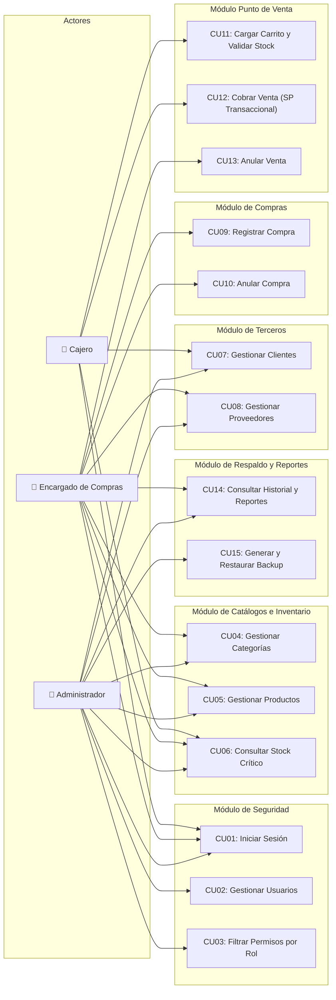

# Especificación de Requisitos de Software (ERS)
**Sistema de Control de Stock, Compras y Punto de Venta (POS) - SistemaVentaStock**  
*Cátedra: Taller de Programación II - Facultad de Ciencias Exactas y Naturales y Agrimensura (FaCENA - UNNE)*  
*Grupo 70*

---

## 1. INTRODUCCIÓN

### 1.1. Breve estado del arte
En el ámbito de la gestión comercial y el control de inventarios para pequeñas y medianas empresas (PyMEs), la administración operativa ha evolucionado desde registros manuales o planillas de cálculo propensas a inconsistencias hacia sistemas informáticos integrados de gestión (ERP) y soluciones dedicadas de Punto de Venta (POS).

Actualmente, el mercado ofrece principalmente dos esquemas de arquitectura:
- **Soluciones en la nube (SaaS)**: Ofrecen accesibilidad remota y mantenimiento centralizado, pero presentan dependencia crítica de una conexión a internet estable, costos de suscripción recurrentes y latencias variables en la atención en caja.
- **Aplicaciones de Escritorio en Red Local (LAN)**: Garantizan máxima velocidad de respuesta (latencias inferiores a 200 ms en búsqueda y cobro), alta disponibilidad operativa sin requerir internet, control total sobre la privacidad de la información y capacidad de procesamiento transaccional atómico local.

El presente proyecto se posiciona en esta última categoría, desarrollando una aplicación de escritorio nativa multi-usuario orientada a comercios minoristas. La solución integra un modelo de control de acceso basado en roles (RBAC), gestión de inventario y catálogos, registro atómico de compras a proveedores con actualización de costos, un módulo de Punto de Venta (POS) con Procedimiento Almacenado transaccional propio (`sp_RegistrarVenta`), inmutabilidad documental, módulo de respaldos/restauración de base de datos para contingencias y trazabilidad mediante bajas lógicas.

### 1.2. Objetivos

#### Objetivo General
Desarrollar una aplicación de escritorio multi-usuario en red local (LAN) que optimice la gestión comercial, el control de inventario y el procesamiento de ventas en punto de venta (POS), garantizando la integridad de la información, la velocidad operativa, la recuperación ante desastres y la trazabilidad de las transacciones.

#### Objetivos Específicos
- **Implementar un control de acceso basado en roles (RBAC)**: Diseñar un esquema de autenticación que habilite o deshabilite dinámicamente las opciones del menú de la interfaz según los permisos asignados a cada rol (*Administrador*, *Encargado*, *Vendedor*).
- **Administrar el catálogo de productos e inventario**: Gestionar rubros y artículos, manteniendo un control riguroso de existencias, código de producto y actualización de precios de costo y venta.
- **Gestionar el proceso de abastecimiento**: Registrar comprobantes de compra asociados a proveedores, incrementando el stock de forma automática y actualizando la estructura de costos.
- **Agilizar la operación en el Punto de Venta (POS)**: Proporcionar una interfaz ágil para la búsqueda e inserción de productos, verificación de stock en tiempo real, cálculo de vuelto en vivo e inmutabilidad en el registro del comprobante mediante Procedimiento Almacenado y transacciones puras en motor SQL Server.
- **Asegurar la trazabilidad e integridad referencial**: Implementar bajas lógicas (`Estado = 0`) para la anulación de transacciones y registros maestros sin pérdida de datos históricos.
- **Garantizar la resiliencia y continuidad operativa**: Proveer al rol Administrador herramientas para generar copias de seguridad nativas (`.bak`) y restaurar la base de datos de manera consistente ante fallos de hardware o corrupción.

### 1.3. Fundamentación
La implementación de este sistema responde a la necesidad crítica de resolver ineficiencias operativas recurrentes en comercios de venta al por menor. En ausencia de un software de gestión dedicado, los negocios enfrentan problemas comunes como el desfasaje entre el stock físico y el registrado, la pérdida de tiempo en el proceso de cobro en caja, la falta de control sobre las actualizaciones de precios tras cada compra a proveedores y la vulnerabilidad de la información por accesos no autorizados.

La elección de una arquitectura de escritorio con almacenamiento en red local (LAN) se justifica formalmente por los siguientes aspectos:
- **Confiabilidad y Disponibilidad Continuada**: Garantiza la operatividad ininterrumpida de las cajas cobradoras sin depender de conectividad a internet o servidores externos, asegurando una baja latencia en la atención al cliente.
- **Integridad de Datos y Reglas de Negocio Atómicas**: La utilización de un motor de base de datos relacional (Microsoft SQL Server) con soporte transaccional ACID previene inconsistencias financieras o de inventario durante el registro simultáneo de ventas y compras mediante bloqueos a nivel de fila (`UPDLOCK`, `HOLDLOCK`).
- **Trazabilidad y Auditoría**: La prohibición de borrados físicos mediante la aplicación de bajas lógicas (`Estado = 0`) asegura la conservación del historial de transacciones, permitiendo auditorías precisas sobre ventas, compras y modificaciones de usuarios.
- **Seguridad Operativa**: El esquema de control de acceso por roles (RBAC) limita la ejecución de tareas sensibles (como anulaciones de comprobantes, ajustes de catálogo o generación de respaldos) únicamente al personal autorizado, reduciendo el margen de error humano y fraudes internos.

### 1.4. Separación de responsabilidades por rol
El rol Administrador corresponde a la administración técnica del sistema y no constituye un superusuario de la operación comercial:
- **Administrador**: Administra usuarios, permisos y los datos maestros autorizados (categorías, productos, clientes y proveedores), consulta información y realiza backup/restauración. No puede registrar compras, operar el carrito de ventas, vender, cobrar ni anular comprobantes comerciales.
- **Encargado de Compras**: Gestiona el catálogo y los proveedores, registra compras, consulta reportes y autoriza y ejecuta las anulaciones de compras y ventas como responsable comercial. No registra ventas ni cobros y no tiene acceso a backup/restauración.
- **Vendedor / Cajero**: Gestiona clientes, consulta existencias y opera el punto de venta, incluyendo carrito, ventas y cobros. No registra compras, no autoriza anulaciones y no tiene acceso a backup/restauración.

Los permisos se verifican en la capa de negocio además de controlar la visibilidad de la interfaz; ningún rol hereda acceso comercial total por su denominación. El ABM de datos maestros no permite editar comprobantes ni modificar existencias por fuera de las reglas de negocio. Toda anulación debe registrar el usuario responsable, la fecha y hora y el motivo, conservando el comprobante original mediante baja lógica.

---

## 2. METODOLOGÍA

### 2.1. Ciclo de Vida
Para el desarrollo del sistema se adoptó un modelo de Ciclo de Vida Iterativo e Incremental, estructurado bajo el marco de trabajo ágil Scrum. Esta elección metodológica responde a la necesidad de gestionar de manera flexible la construcción modular del software, permitiendo entregas parciales y funcionales al finalizar cada ciclo de trabajo.

- **Naturaleza Incremental**: El sistema evoluciona mediante la adición progresiva de módulos operativos. Se inicia con el núcleo de seguridad y acceso (RBAC), continúa con los catálogos maestros (categorías, productos, clientes y proveedores), avanza hacia el motor transaccional (compras y ventas POS) y finaliza con la gestión de anulaciones, trazabilidad, respaldos y reportes.
- **Naturaleza Iterativa**: Cada incremento permite revisar, refinar y ajustar artefactos de diseño (como el Diagrama Entidad-Relación, los contratos de repositorio, los esquemas de procedimientos almacenados o la interfaz gráfica en WinForms) a medida que se profundiza en las reglas de negocio y se validan las funcionalidades desarrolladas.

### 2.2. Método de Educción de Requisitos
La educción de requisitos se llevó a cabo mediante un proceso estructurado de interacción con los actores clave y el análisis del dominio del problema. Se combinaron técnicas cualitativas para extraer, refinar y consensuar las necesidades operativas del comercio, transformándolas en requisitos del sistema.

#### 2.2.1. Entrevista
Se aplicó la técnica de la Pirámide Invertida a través de entrevistas semiestructuradas con los futuros usuarios (Administrador, Encargado de Compras y Cajero). Esta secuencia metodológica permitió ir desde los problemas generales de la gestión comercial hasta la definición precisa de las reglas de negocio en la base de datos:

1. **Fase Exploratoria (Preguntas Abiertas)**:
   - *Objetivo*: Detectar las problemáticas principales del flujo de trabajo diario y los cuellos de botella operativos.
   - *Hallazgos*: Se identificó la falta de sincronización entre el stock real y el registrado, la tardanza en el cobro en caja en momentos de alta concurrencia y la desactualización de precios de venta tras la entrada de nueva mercadería.
2. **Fase de Profundización (Preguntas Semiestructuradas)**:
   - *Objetivo*: Detallar los mecanismos de control, el comportamiento esperado del sistema ante excepciones y la definición de roles.
   - *Hallazgos*: Se especificó que al recibir la mercadería de una compra debían actualizarse de forma simultánea el stock y el costo de compra, manteniendo el precio de venta bajo gestión independiente del catálogo. Para la venta en el POS, se determinó la necesidad del cálculo automático del vuelto (`MontoCambio`), la consulta instantánea de productos por código de producto y la resolución fluida de ventas a *Consumidor Final*.
3. **Fase de Validación (Preguntas Cerradas)**:
   - *Objetivo*: Confirmar restricciones técnicas, políticas de auditoría, comportamiento de persistencia y planes de recuperación.
   - *Hallazgos*: Se acordó de manera categórica que el sistema no permitirá borrados físicos (`DELETE`), reemplazándolos por bajas lógicas mediante la columna `Estado = 0`. Asimismo, se ratificó el bloqueo estricto de ventas si el stock es insuficiente (`Stock < Cantidad`), la copia inmutable de los datos del cliente (`DocumentoCliente`, `NombreCliente`) en la cabecera de la venta, la ejecución del registro en caja mediante un Stored Procedure con Transacción SQL pura, y la inclusión de herramientas de backup/restore exclusivo para el Administrador.

---

## 3. PLANIFICACIÓN DEL PROYECTO Y ÉPICAS

### 3.1. Estructura de Épicas
Las funcionalidades del sistema se agrupan en 7 Épicas globales:
- **EP-01: Seguridad, Autenticación y Gestión de Roles**: Gestión de identidades, autenticación segura con hash BCrypt y filtrado dinámico de interfaces según los roles (*Administrador*, *Encargado*, *Vendedor*).
- **EP-02: Gestión de Catálogos Maestros e Inventario**: Administración de rubros (categorías) y productos, ingreso manual de códigos de producto mediante teclado, monitoreo en tiempo real de stock y umbral de inventario crítico.
- **EP-03: Gestión de Terceros**: Administración de los padrones de clientes y proveedores para su vinculación con transacciones comerciales.
- **EP-04: Gestión de Abastecimiento y Compras**: Recepción de facturas de proveedores, carga del detalle de compra, incremento atómico de existencias y actualización automática del costo de compra, sin modificar el precio de venta.
- **EP-05: Punto de Venta (POS) y Facturación Transaccional**: Procesamiento de ventas en caja con carrito en memoria, validación de existencias, cálculo automático de vuelto en vivo, persistencia atómica mediante Procedimiento Almacenado propio (`sp_RegistrarVenta`) con transacción SQL pura, descuento de stock e inmutabilidad de datos de cliente.
- **EP-06: Anulaciones, Trazabilidad y Reportes**: Cancelación controlada de operaciones con reversión automática de stock, consulta de históricos con filtros por fechas/comprobantes y resumen ejecutivo de métricas en el Home.
- **EP-07: Resiliencia, Continuidad y Resguardo de Datos**: Generación manual de copias de seguridad (`.bak`) y restauración de base de datos exclusiva para el rol Administrador, con bloqueo de concurrencia y validaciones de ruta.

---

## 4. ESPECIFICACIÓN DE HISTORIAS DE USUARIO (HU)

### Épica 1: Seguridad, Autenticación y Gestión de Roles

#### HU-01: Autenticación de Usuarios en el Sistema
- **Actor**: Todos los usuarios.
- **Descripción**: Como usuario del sistema, quiero ingresar mi documento y contraseña para acceder a las funciones autorizadas según mi rol.
- **Criterios de Aceptación**:
  - Valida que el `USUARIO` exista y la `Clave` cifrada (BCrypt) coincida.
  - Al iniciar sesión, el sistema identifica el `ROL` del usuario y habilita las opciones correspondientes al perfil.
  - Verifica que el usuario tenga `Estado = 1`. Si tiene `Estado = 0`, bloquea el acceso informando: *"Usuario inactivo. Contacte al administrador"*.
  - Bloquea temporalmente el intento de inicio de sesión tras 3 intentos fallidos consecutivos para prevenir ataques de fuerza bruta.

#### HU-02: Carga Dinámica de Menúes por Permisos
- **Actor**: Todos los usuarios.
- **Descripción**: Como usuario autenticado, quiero visualizar únicamente los módulos y opciones de menú habilitados para mi rol.
- **Criterios de Aceptación**:
  - La interfaz gráfica oculta o deshabilita dinámicamente las pestañas y controles que no pertenezcan al rol del usuario activo.
  - Los atajos de teclado y accesos directos quedan restringidos estrictamente a las funciones autorizadas.

#### HU-03: Gestión de Cuentas de Usuario
- **Actor**: Administrador.
- **Descripción**: Como administrador, quiero crear, modificar y dar de baja usuarios para gestionar los accesos al sistema.
- **Criterios de Aceptación**:
  - Registra Documento (DNI), Nombre, Apellido, Correo, Sexo, Clave cifrada y asigna un `IdRol` obligatorio.
  - Valida que el DNI y el Correo sean únicos en la base de datos.
  - Aplica baja lógica cambiando `Estado = 0` (prohibido el borrado físico de la tabla `USUARIO`).

---

### Épica 2: Gestión de Catálogos Maestros e Inventario

#### HU-04: Gestión de Categorías / Rubros
- **Actor**: Encargado de Compras / Administrador.
- **Descripción**: Como encargado de compras o administrador, quiero administrar los rubros para clasificar los productos del inventario.
- **Criterios de Aceptación**:
  - Permite crear y modificar registros en la tabla `CATEGORIA` (`Descripcion`).
  - Despliega únicamente las categorías activas (`Estado = 1`) en los desplegables de selección.
  - Aplica baja lógica (`Estado = 0`) previa validación de que no existan productos activos vinculados al rubro.

#### HU-05: Registro y Edición de Productos
- **Actor**: Encargado de Compras / Administrador.
- **Descripción**: Como encargado de compras o administrador, quiero dar de alta y actualizar productos en el catálogo para disponer del inventario al día.
- **Criterios de Aceptación**:
  - Captura Código, Nombre, Descripción, Categoría, PrecioCompra y PrecioVenta.
  - Exige la unicidad del código de producto ingresado manualmente mediante teclado.
  - Asigna `Stock = 0` por defecto en el alta inicial si no proviene de un ingreso directo o compra.
  - Permite modificar precios y datos conservando la trazabilidad de la última modificación (`IdUsuarioModifica`, `FechaModificacion`).

#### HU-06: Consulta de Stock e Inventario Crítico
- **Actor**: Encargado de Compras / Cajero / Administrador.
- **Descripción**: Como operador, quiero consultar el stock disponible y filtrar aquellos productos que se encuentren en nivel crítico.
- **Criterios de Aceptación**:
  - Permite buscar por código de producto, nombre o filtrar por categoría.
  - Muestra en grilla: Código, Producto, Rubro, Stock actual, Costo y Precio de Venta.
  - Resalta visualmente aquellos artículos con `Stock = 0` o cuyo inventario esté por debajo del umbral mínimo parametrizado en la configuración (`StockCritico:UmbralMinimo`).

---

### Épica 3: Gestión de Terceros

#### HU-07: Administración del Padrón de Clientes
- **Actor**: Cajero / Administrador.
- **Descripción**: Como cajero o administrador, quiero registrar y actualizar los datos de los clientes para asociarlos a los comprobantes de venta.
- **Criterios de Aceptación**:
  - Captura DNI/Documento, Nombre, Apellido, Correo y Teléfono.
  - Valida formato de correo y formato numérico de teléfono.
  - Valida la unicidad del Documento en la tabla `CLIENTE`.
  - Provee búsqueda rápida optimizada (`BuscarClientesParaPosAsync`) para autocompletar en el Punto de Venta.

#### HU-08: Administración del Padrón de Proveedores
- **Actor**: Encargado de Compras / Administrador.
- **Descripción**: Como encargado de compras o administrador, quiero registrar proveedores para gestionar el abastecimiento de mercadería.
- **Criterios de Aceptación**:
  - Captura CUIT (11 dígitos numéricos), Razón Social, Correo y Teléfono.
  - Exige la unicidad de CUIT en la tabla `PROVEEDOR`.
  - Aplica baja lógica (`Estado = 0`) en caso de cese de relación comercial.

---

### Épica 4: Gestión de Abastecimiento y Compras

#### HU-09: Solicitudes de Reabastecimiento a Proveedores y Envío por Correo
- **Actor**: Encargado de Compras exclusivamente.
- **Descripción**: Como encargado de compras, quiero generar solicitudes de reabastecimiento a proveedores, enviárselas por correo electrónico y registrar su confirmación con los costos acordados.
- **Criterios de Aceptación**:
  - Permite seleccionar un proveedor activo (`Estado = 1`), asociar el operador responsable y elegir productos del catálogo (destacando aquellos con `Stock <= StockMinimo`).
  - Al emitir el pedido con las cantidades requeridas, registra la solicitud en estado **`Pendiente`** (`EstadoSolicitud = 'Pendiente'`) sin modificar aún las existencias de `PRODUCTO`.
  - Despacha la solicitud al correo electrónico del proveedor mediante SMTP configurable en `appsettings.json` (con modo simulación/vista previa local cuando se opere sin conectividad SMTP).
  - Permite pasar el pedido al estado **`Confirmada`** cuando el proveedor responde confirmando disponibilidad y costos unitarios (`PrecioCompra`), recalculando subtotales y `MontoTotal`. El precio de venta se gestiona de forma independiente en el catálogo de Productos.

#### HU-10: Recepción de Mercadería y Actualización Automática de Stock y Costo
- **Actor**: Encargado de Compras / Sistema.
- **Descripción**: Como encargado de compras, quiero cambiar el estado del pedido a **`Recibida`** al ingresar la mercadería al local para que el sistema actualice automáticamente las existencias y el costo de compra, sin modificar el precio de venta del catálogo.
- **Criterios de Aceptación**:
  - Al cambiar el estado de la compra a **`Recibida`**, incrementa de forma atómica `PRODUCTO.Stock` sumando las cantidades adquiridas en cada línea de `DETALLE_COMPRA`.
  - Actualiza `PrecioCompra` en `PRODUCTO` según los costos confirmados en la solicitud. Conserva `PrecioVenta`, que se modifica exclusivamente desde el catálogo de Productos.

---

### Épica 5: Punto de Venta (POS) y Facturación

#### HU-11: Búsqueda y Validación de Productos en Caja (Carrito POS)
- **Actor**: Vendedor / Cajero exclusivamente.
- **Descripción**: Como cajero, quiero buscar productos ingresando manualmente su código o nombre mediante teclado y agregarlos a un carrito interactivo validando stock en tiempo real.
- **Criterios de Aceptación**:
  - Búsqueda asíncrona reactiva con debounce de 300 ms por código de producto o nombre.
  - Verificación de stock disponible previo al agregado. Si la cantidad solicitada excede las existencias, rechaza la operación e informa: *"Stock insuficiente. Disponible: X"*.
  - Acumula cantidades sobre la misma línea de la grilla si el producto ya fue seleccionado, recalculando subtotales y total general.
  - Permite editar la cantidad directamente desde la celda de la grilla o remover líneas seleccionadas.

#### HU-12: Procesamiento de Cobro, Vuelto, Transacción SQL e Inmutabilidad
- **Actor**: Vendedor / Cajero exclusivamente.
- **Descripción**: Como cajero, quiero procesar el cobro de la venta, calcular el vuelto exacto y registrar el comprobante de forma atómica e inmutable en base de datos.
- **Criterios de Aceptación**:
  - Muestra el total liquidado de la venta en tiempo real.
  - Permite seleccionar un cliente del padrón o utilizar por defecto la opción **Consumidor Final** (con botón directo de restablecimiento).
  - Al ingresar el importe entregado por el cliente en *"Paga con $"*, calcula dinámicamente el vuelto (`MontoCambio = MontoPago - MontoTotal`). Si el importe es menor al total, inhabilita el botón de facturación y muestra el importe faltante.
  - **Criterio Académico Obligatorio (Transacción SQL y SP Propio)**: La persistencia definitiva se ejecuta mediante el Procedimiento Almacenado `dbo.sp_RegistrarVenta`, el cual:
    - Utiliza un parámetro de tabla tipado (`dbo.TipoDetalleVenta`).
    - Inicia una transacción SQL pura (`BEGIN TRANSACTION`).
    - Aplica bloqueo exclusivo de filas (`UPDLOCK`, `HOLDLOCK`) sobre `PRODUCTO` para verificar y descontar stock de forma atómica y concurrente.
    - Inserta la cabecera `VENTA` grabando de forma fija e **inmutable** los snapshots `documento_cliente` y `nombre_cliente`.
    - Inserta los ítems en `DETALLE_VENTA` e incrementa el número secuencial en `TIPO_FACTURA`.
    - Realiza `COMMIT TRANSACTION` en caso de éxito o `ROLLBACK TRANSACTION` inmediato si ocurre algún error de stock o persistencia.
  - Tras la confirmación, vacía automáticamente el carrito y habilita el comprobante para entrega o impresión.

---

### Épica 6: Anulaciones, Trazabilidad y Reportes

#### HU-13: Anulación de Ventas y Restitución de Stock
- **Actor**: Encargado de Compras exclusivamente.
- **Descripción**: Como encargado de compras y responsable comercial, quiero anular una venta registrada para cancelar la operación comercial y restituir la mercadería al almacén.
- **Criterios de Aceptación**:
  - Exige autenticación y autorización del rol Encargado de Compras; el Administrador técnico y el Cajero no pueden ejecutarla.
  - Registra el usuario responsable, la fecha y hora y el motivo de la anulación.
  - Actualiza la cabecera `VENTA.Estado = 0`.
  - Recorre las líneas de `DETALLE_VENTA` y suma automáticamente las cantidades de regreso a `PRODUCTO.Stock`.

#### HU-14: Anulación de Compras y Ajuste de Stock
- **Actor**: Encargado de Compras exclusivamente.
- **Descripción**: Como encargado de compras y responsable comercial, quiero cancelar o anular una solicitud/compra ajustando las existencias del inventario según su estado de recepción.
- **Criterios de Aceptación**:
  - Exige autenticación y autorización del rol Encargado de Compras; el Administrador técnico y el Cajero no pueden ejecutarla.
  - Registra el usuario responsable, la fecha y hora y el motivo de la anulación (`id_usuario_anula`, `fecha_anulacion`, `motivo_anulacion`).
  - Si la compra se encontraba en estado **`Pendiente`** o **`Confirmada`**, pasa a **`Anulada`** (`COMPRA.Estado = 0`) sin modificar `PRODUCTO.Stock`.
  - Si la compra ya se encontraba en estado **`Recibida`**, verifica que `PRODUCTO.Stock >= CantidadComprada`. Si las existencias actuales son insuficientes (debido a ventas posteriores), cancela la anulación y emite una advertencia; si hay stock suficiente, cambia a **`Anulada`** (`COMPRA.Estado = 0`) y descuenta las unidades de `PRODUCTO.Stock`.

#### HU-15: Histórico de Transacciones y Tablero de Reportes con Vistas SQL
- **Actor**: Administrador / Encargado de Compras.
- **Descripción**: Como usuario gestor, quiero consultar el tablero de reportes alimentado por vistas SQL en base de datos y los históricos de ventas y compras con filtros avanzados para evaluar el desempeño comercial real.
- **Criterios de Aceptación**:
  - Utiliza Vistas SQL (`CREATE VIEW`, como `vw_ResumenDiarioVentas` y `vw_ParticipacionCategorias`) para calcular agregaciones de facturación, ganancias, ticket promedio y participación por rubro directamente en el motor.
  - Alimenta los KPIs, gráficos y tabla de resumen diario de `ReportesForm` con datos reales filtrables por período.
  - Permite filtrar listados históricos de transacciones por rango de fechas (desde/hasta), cliente, proveedor o estado (`Activa`, `Anulada`, `Pendiente`, `Confirmada`, `Recibida`).
  - Provee métricas resumidas en la pantalla de inicio (ventas del día, monto total transaccionado, conteo de stock crítico).

---

### Épica 7: Resiliencia, Continuidad y Resguardo de Datos

#### HU-16: Backup y Restauración de Base de Datos para Administrador
- **Actor**: Administrador exclusivamente.
- **Descripción**: Como administrador, quiero generar copias de seguridad manuales de la base de datos y disponer de la capacidad de restaurarla para garantizar la continuidad del negocio ante fallos.
- **Criterios de Aceptación**:
  - La funcionalidad se aloja en el panel principal (`Home`), visible y ejecutable **únicamente para el rol Administrador**.
  - **Generación de Backup**:
    - Ejecuta el comando nativo `BACKUP DATABASE [DB_SISTEMA_VENTA] TO DISK = ... WITH FORMAT, INIT`.
    - Genera un archivo con timestamp (`DB_SISTEMA_VENTA_yyyyMMdd_HHmmss.bak`) en una ruta configurada (`Respaldos:RutaCarpeta`) o en la raíz de la solución por defecto.
    - Emite un mensaje de confirmación sin exponer credenciales ni rutas internas sensibles.
  - **Restauración de Base de Datos**:
    - Requiere selección manual de un archivo `.bak` válido.
    - Exige una confirmación explícita mediante cuadro de advertencia que advierte sobre la sobreescritura de los datos actuales.
    - Establece acceso exclusivo al motor (`ALTER DATABASE ... SET SINGLE_USER WITH ROLLBACK IMMEDIATE`), ejecuta `RESTORE DATABASE ... WITH REPLACE` y restituye el acceso multi-usuario (`SET MULTI_USER`).
    - Bloquea la interfaz gráfica durante el proceso y desbloquea los controles automáticamente tanto ante éxito, cancelación o error.

---

## 5. ESPECIFICACIÓN DE REQUISITOS (ESTÁNDAR IEEE 830-1998)

### 5.1. Requisitos Funcionales (RF)

| ID | Nombre del Requisito | Entrada | Proceso | Salida |
| :--- | :--- | :--- | :--- | :--- |
| **RF-01** | Autenticación de Usuarios | DNI y Clave | Verifica existencia, estado activo y valida hash BCrypt. Bloquea al 3er fallo. | Acceso concedido al menú principal o mensaje de rechazo. |
| **RF-02** | Filtrado Dinámico de Interfaz (RBAC) | Rol del usuario autenticado | Evalúa permisos explícitos por rol en la interfaz y la capa de negocio, sin otorgar acceso comercial total al Administrador técnico. | Ventana principal renderizada con los módulos habilitados para el rol. |
| **RF-03** | ABM de Usuarios con Baja Lógica | Datos de usuario y rol | Valida unicidad de DNI y correo. En bajas establece `Estado = 0`. | Usuario registrado, modificado o inactivado en `USUARIO`. |
| **RF-04** | ABM de Categorías | Descripción de rubro | Valida unicidad y previene baja lógica si existen productos activos vinculados. | Registro en `CATEGORIA` con `Estado = 1` o `0`. |
| **RF-05** | Catálogo de Productos y Precios | Código, Nombre, Rubro, Costo, Precio | Valida unicidad de código de producto. Gestiona stock y precios de venta. | Ficha de artículo actualizada en `PRODUCTO`. |
| **RF-06** | Alertas de Stock Crítico | Umbral mínimo configurado | Evalúa existencias en tiempo real y detecta artículos con `Stock <= Umbral`. | Grilla de inventario con resaltado visual y resumen en Home. |
| **RF-07** | Padrón de Clientes y Búsqueda POS | DNI, Nombre, Correo, Teléfono | Registra clientes validados y expone búsqueda optimizada para caja. | Cliente en `CLIENTE` y listado rápido para el POS. |
| **RF-08** | Padrón de Proveedores | CUIT, Razón Social, Contacto | Valida formato fiscal CUIT (11 dígitos) y unicidad. Gestiona bajas lógicas. | Proveedor persistido en `PROVEEDOR`. |
| **RF-09** | Solicitudes de Reabastecimiento y Envío por Email | Encargado de Compras autenticado, proveedor y lista de ítems | Registra la solicitud en estado `Pendiente`, envía el pedido por SMTP (con fallback local) y permite confirmarla (`Confirmada`) con costos acordados. | Solicitud de compra registrada y despachada al proveedor. |
| **RF-10** | Recepción de Mercadería y Entrada de Stock | Solicitud de compra marcada como `Recibida` | Suma atómicamente las cantidades recibidas a `PRODUCTO.Stock` y actualiza `PrecioCompra` (costo de reposición). El precio de venta permanece gestionado en el catálogo. | `PRODUCTO.Stock` incrementado y costo unitario actualizado en `PRODUCTO`. |
| **RF-11** | Carrito y Validación de Existencias en Caja | Vendedor / Cajero autenticado, Código ingresado mediante teclado / Nombre, Cantidad | Verifica `Stock >= Cantidad`. Rechaza adición si no hay existencias suficientes. | Línea incorporada al carrito con subtotal y total recalculados. |
| **RF-12** | Inmutabilidad de Clientes en Venta | Cliente del padrón o Consumidor Final | Captura de forma congelada `documento_cliente` y `nombre_cliente` en la cabecera. | Datos del cliente inmutables guardados en `VENTA`. |
| **RF-13** | Cobro y Cálculo Dinámico de Vuelto | Vendedor / Cajero autenticado, importe de pago (`MontoPago`) | Compara `MontoPago >= MontoTotal` y calcula `MontoCambio = MontoPago - MontoTotal`. | Vuelto visualizado en tiempo real y habilitación de facturación. |
| **RF-14** | Persistencia Atómica de Venta vía SP | Vendedor / Cajero autenticado, parámetros de venta y tabla de detalles | Invoca `sp_RegistrarVenta` con transacción pura, bloqueo de stock e inserción de venta y detalles. | Venta N° persistida, stock descontado y carrito reiniciado. |
| **RF-15** | Anulación de Ventas con Devolución de Stock | ID de Venta y motivo (Solo Encargado de Compras) | Registra auditoría, cambia `VENTA.Estado = 0` y suma las cantidades de `DETALLE_VENTA` al stock. | Venta anulada y stock físico restituido. |
| **RF-16** | Anulación de Compras según Estado | ID de Compra y motivo (Solo Encargado de Compras) | Registra auditoría y pasa a `Anulada`; si estaba `Recibida`, verifica `Stock >= CantidadComprada` y resta stock. | Compra anulada y stock corregido cuando corresponda. |
| **RF-17** | Generación de Copia de Seguridad (Backup) | Comando del Administrador | Ejecuta `BACKUP DATABASE` en SQL Server y genera archivo `.bak` con fecha y hora. | Respaldo físico creado en disco y confirmación en pantalla. |
| **RF-18** | Restauración de Base de Datos (Restore) | Archivo `.bak` seleccionado y confirmación | Forza modo exclusivo (`SINGLE_USER`), ejecuta `RESTORE DATABASE` y restablece `MULTI_USER`. | Base de datos recuperada al punto del respaldo. |
| **RF-19** | Tablero de Reportes mediante Vistas SQL | Período y filtros seleccionados | Consulta vistas SQL (`vw_ResumenDiarioVentas`, `vw_ParticipacionCategorias`) e históricos reales. | KPIs, gráficos y grillas de desempeño comercial actualizados. |

---

### 5.2. Requisitos No Funcionales (RNF)

- **RNF-01 (Tiempo de Respuesta en Caja)**: La búsqueda de productos por código de producto o texto debe procesar y actualizar la vista en menos de 300 ms.
- **RNF-02 (Procesamiento Transaccional)**: La confirmación y registro de una venta completa a través del Stored Procedure en red local no debe superar los 1.5 segundos.
- **RNF-03 (Concurrencia sin Bloqueos Sucios)**: El motor SQL debe soportar múltiples terminales de caja operando en simultáneo mediante transacciones atómicas con bloqueos acotados a nivel de fila (`UPDLOCK`, `HOLDLOCK`), evitando lecturas sucias y deadlocks.
- **RNF-04 (Seguridad de Credenciales)**: Las contraseñas de los usuarios deben almacenarse irreversiblemente cifradas utilizando el algoritmo **BCrypt** con factor de costo adecuado.
- **RNF-05 (Aislamiento Arquitectónico en 4 Capas)**: El sistema debe estructurarse estrictamente en capas desacopladas (*CapaPresentacion*, *CapaNegocio*, *CapaDatos*, *CapaEntidad*). La interfaz de usuario tiene terminantemente prohibido acceder a la base de datos o invocar comandos SQL directos.
- **RNF-06 (Disponibilidad Offline en LAN)**: La totalidad de los módulos operativos (caja, compras, catálogos y reportes) debe funcionar de forma autónoma en la red local del comercio, sin requerir acceso a internet.
- **RNF-07 (Inmutabilidad Histórica)**: Todo comprobante registrado en firme no puede ser editado ni eliminado físicamente. Las correcciones se efectúan exclusivamente mediante anulaciones lógicas y comprobantes de ajuste.
- **RNF-08 (Manejo Centralizado de Excepciones)**: Los errores de infraestructura o base de datos deben ser interceptados y traducidos a mensajes claros en español comprensibles por el usuario, sin exponer trazas técnicas (`stack traces`) ni cadenas de conexión.
- **RNF-09 (Operación con Teclado y Mouse)**: La interfaz del Punto de Venta debe permitir ingresar manualmente el código o nombre del producto mediante teclado, seleccionar resultados con teclado o mouse y confirmar la cantidad mediante Enter o el botón de agregado al carrito.
- **RNF-10 (Integridad Referencial Estricta)**: La base de datos debe aplicar restricciones de clave foránea con eliminación restringida (`ON DELETE RESTRICT`) en entidades maestras para evitar registros huérfanos.

---

## 6. ANÁLISIS Y MATRIZ DE RIESGOS

### 6.1. Identificación de Riesgos
- **R-01 (Corte de Suministro Eléctrico en Servidor)**: Apagado repentino del equipo que aloja la base de datos durante una transacción de venta o compra.
- **R-02 (Condiciones de Carrera por Venta Simultánea)**: Dos cajeros intentando cobrar la última unidad disponible de un mismo producto en el mismo milisegundo.
- **R-03 (Corrupción o Pérdida de Datos)**: Daño físico en el almacenamiento o fallo del sistema operativo que comprometa la base `DB_SISTEMA_VENTA`.
- **R-04 (Falla o Desconexión de Red Local LAN)**: Pérdida momentánea de comunicación entre una terminal de caja y el servidor SQL.
- **R-05 (Error Humano en Precios de Costo/Venta)**: Ingreso accidental de importes irrisorios o desproporcionados en comprobantes de compra.
- **R-06 (Intento de Fraude por Anulación Indebida)**: Operador no autorizado intentando anular ventas para sustraer dinero de la caja.
- **R-07 (Error en el Ingreso Manual del Código)**: Ingreso incorrecto o incompleto del código de producto que impida localizar el artículo deseado.
- **R-08 (Agotamiento de Existencias durante la Atención)**: Quiebre de stock no anticipado al momento de añadir mercadería a la cinta de caja.
- **R-09 (Vulneración de Accesos por Credenciales Débiles)**: Uso de contraseñas obvias o compartidas entre operadores.
- **R-10 (Alteración de Datos de Clientes en Ventas Pasadas)**: Modificación del nombre o razón social de un cliente que altere comprobantes fiscales históricos.

### 6.2. Matriz Cualitativa de Riesgos

| ID | Riesgo Identificado | Categoría | Probabilidad | Impacto | Nivel de Riesgo |
| :---: | :--- | :--- | :---: | :---: | :---: |
| **R-01** | Corte eléctrico durante escritura | Tecnológico | Media | Crítico | **Alto** |
| **R-02** | Carrera por stock simultáneo | Concurrencia | Alta | Alto | **Crítico** |
| **R-03** | Corrupción / Pérdida de base de datos | Infraestructura | Baja | Catastrófico | **Alto** |
| **R-04** | Caída de conexión LAN | Infraestructura | Media | Alto | **Alto** |
| **R-05** | Error humano en carga de precios | Operativo | Alta | Medio | **Medio** |
| **R-06** | Fraude por anulación no supervisada | Seguridad | Media | Alto | **Alto** |
| **R-07** | Error en el ingreso manual del código | Operativo | Media | Bajo | **Bajo** |
| **R-08** | Quiebre de stock inesperado | Operativo | Alta | Medio | **Medio** |
| **R-09** | Contraseñas vulnerables | Seguridad | Media | Medio | **Medio** |
| **R-10** | Pérdida de inmutabilidad documental | Integridad | Media | Alto | **Alto** |

### 6.3. Estrategias de Mitigación y Planes de Contingencia

| ID | Estrategia de Mitigación Preventiva | Plan de Contingencia / Respuesta |
| :---: | :--- | :--- |
| **R-01** | Motor transaccional con diario de registro WAL (`Write-Ahead Logging`) y uso de SAI/UPS en el equipo principal. | Recuperación automática del motor mediante rollback de transacciones no confirmadas al reiniciar. |
| **R-02** | Bloqueo pesimista de fila en Procedimiento Almacenado mediante `WITH (UPDLOCK, HOLDLOCK)`. | El motor serializa las solicitudes; el segundo cajero recibe mensaje claro: *"Stock insuficiente. Disponible: 0"*. |
| **R-03** | Módulo de respaldos nativos diarios (`.bak`) gestionado por el Administrador (HU-16). | Restauración íntegra de la base desde el último respaldo mediante el asistente de `RestaurarBackupForm`. |
| **R-04** | Protocolo TCP/IP optimizado con tiempos de espera configurables en la cadena de conexión. | Mensaje de reconexión amigable en pantalla; no se pierden transacciones intermedias no confirmadas. |
| **R-05** | Validaciones numéricas estrictas en capa de negocio (mayores a cero, máximo 2 decimales y límites de rango). | El sistema rechaza la carga de la línea indicando el campo erróneo antes de impactar en la base de datos. |
| **R-06** | Esquema de autorización estricto RBAC: botones, rutas y operaciones de negocio de anulación habilitados exclusivamente para el Encargado de Compras. | Auditoría completa con registro de fecha, hora, usuario y motivo de cada anulación. |
| **R-07** | Búsqueda por código exacto o coincidencia de nombre, con visualización del producto y sus existencias antes de agregarlo al carrito. | Corregir el código ingresado o buscar por nombre y seleccionar el producto correspondiente. |
| **R-08** | Monitoreo visual de stock crítico en Home y bloqueo inmediato en caja si `Stock < Cantidad`. | Reposición de mercadería guiada por el panel de alertas de inventario. |
| **R-09** | Cifrado BCrypt de contraseñas y bloqueo automático de cuenta tras 3 intentos fallidos. | Desbloqueo y reseteo manual de clave gestionado directamente por el Administrador. |
| **R-10** | Duplicación inmutable de `documento_cliente` y `nombre_cliente` directamente en la tabla `VENTA`. | Aunque el cliente modifique su DNI o apellido en el padrón, la factura histórica conserva los datos del momento. |

---

## 7. MODELADO DE CASOS DE USO

