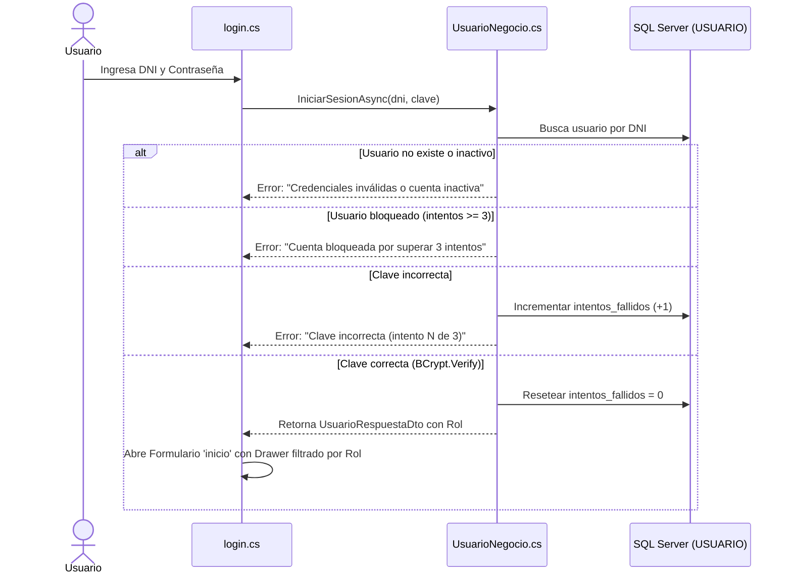

# 🔐 Módulo 01: Seguridad, Autenticación y Usuarios

## Resumen Ejecutivo
Gestiona el acceso al sistema, la autenticación de usuarios mediante credenciales encriptadas y el control de accesos basado en roles (RBAC).

---

## 1. Puntos Clave para la Defensa

| Concepto | Implementación Técnica | Ubicación en Código |
|---|---|---|
| **Cifrado de Claves** | `BCrypt.Net` con salt automático (work factor 12). Nunca texto plano. | [CapaNegocio/UsuarioNegocio.cs](file:///home/nestorgariglio/repositories/university/proyecto_taller_programacion_2/CapaNegocio/UsuarioNegocio.cs) |
| **Bloqueo por Intentos** | Máximo **3 intentos fallidos**. Al 3°, `estado = false` e `intentos_fallidos = 3`. | [CapaNegocio/UsuarioNegocio.cs](file:///home/nestorgariglio/repositories/university/proyecto_taller_programacion_2/CapaNegocio/UsuarioNegocio.cs) |
| **Desbloqueo de Cuenta** | El Administrador puede editar el usuario, restablecer intentos a 0 y reactivarlo. | [CapaPresentacion/Usuarios/GestionUsuariosControl.cs](file:///home/nestorgariglio/repositories/university/proyecto_taller_programacion_2/CapaPresentacion/Usuarios/GestionUsuariosControl.cs) |
| **Roles Soportados** | `Administrador`, `Encargado`, `Vendedor`. | [CapaEntidad/Rol.cs](file:///home/nestorgariglio/repositories/university/proyecto_taller_programacion_2/CapaEntidad/Rol.cs) |
| **Matriz de Permisos** | Centralizada en `PoliticaAcceso`. Sin dispersión de `if/else` en UI. | [CapaNegocio/PoliticaAcceso.cs](file:///home/nestorgariglio/repositories/university/proyecto_taller_programacion_2/CapaNegocio/PoliticaAcceso.cs) |

---

## 2. Matriz de Autorización (`PoliticaAcceso`)

| Módulo / Operación | Administrador | Encargado | Vendedor |
|---|:---:|:---:|:---:|
| **Gestión de Usuarios** | ✅ Total | ❌ | ❌ |
| **Catálogo de Productos** | ✅ Total | ✅ Total | ❌ Solo lectura en POS |
| **Categorías de Productos** | ✅ Total | ✅ Total | ❌ |
| **Padrón de Proveedores** | ✅ Total | ✅ Total | ❌ |
| **Padrón de Clientes** | ✅ Total | ✅ Total | ✅ Alta / Consulta rápida |
| **Módulo de Compras** | ❌ (Solo gestión) | ✅ Operar compras | ❌ |
| **Módulo de Ventas (POS)** | ❌ (Solo consulta) | ✅ Operar y anular | ✅ Operar ventas |
| **Anulación de Operaciones** | ✅ Autorizado | ✅ Autorizado | ❌ Denegado |
| **Tablero de Reportes** | ✅ Total | ✅ Total | ❌ |
| **Backup y Restauración** | ✅ Total | ❌ | ❌ |

---

## 3. Flujo Técnico de Autenticación

---

## 4. Preguntas Frecuentes de Examen

- **¿Dónde se verifica la contraseña?**: En `UsuarioNegocio.AutenticarAsync()` mediante `BCrypt.Net.BCrypt.Verify(claveIngresada, usuario.Clave)`.
- **¿Cómo se ocultan las pestañas a las que un rol no tiene acceso?**: En [inicio.cs](file:///home/nestorgariglio/repositories/university/proyecto_taller_programacion_2/CapaPresentacion/Inicio/inicio.cs), el método `ConfigurarNavegacionPorRol()` invoca `PoliticaAcceso.TieneAcceso(rol, modulo)`. Si devuelve `false`, se remueve la pestaña del `MaterialTabControl`.
