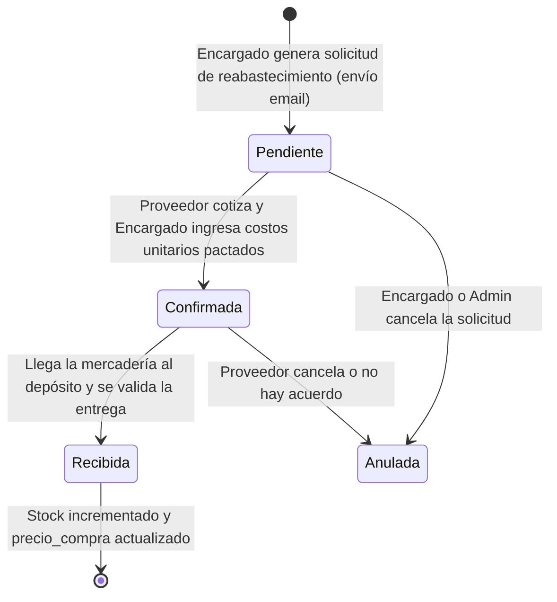

# 🛒 Módulo 04: Compras y Reabastecimiento a Proveedores

## Resumen Ejecutivo
Implementa el ciclo de vida completo de aprovisionamiento de mercadería con arquitectura desacoplada, desde la solicitud de cotización por correo hasta la confirmación de costos pactados y la recepción física en depósito con actualización de stock.

---

## 1. Puntos Clave para la Defensa

| Concepto | Implementación Técnica | Ubicación en Código |
|---|---|---|
| **Ciclo Desacoplado (HU-09)** | 3 estados formales: `Pendiente` (solicitud enviada) -> `Confirmada` (costo acordado ingresado) -> `Recibida` (ingreso físico a depósito). | [CapaEntidad/Compra.cs](file:///home/nestorgariglio/repositories/university/proyecto_taller_programacion_2/CapaEntidad/Compra.cs) |
| **Confirmación de Costos** | Al confirmar la solicitud, el encargado debe ingresar el precio unitario acordado con el proveedor para cada ítem. | [CapaPresentacion/Compras/DetalleCompraForm.cs](file:///home/nestorgariglio/repositories/university/proyecto_taller_programacion_2/CapaPresentacion/Compras/DetalleCompraForm.cs) |
| **Actualización de Stock y Costo (HU-10)** | Al marcar `Recibida`:   1) `Stock = Stock + CantidadRecibida`.  2) `precio_compra = CostoAcordadoCompra`. | [CapaNegocio/CompraNegocio.cs](file:///home/nestorgariglio/repositories/university/proyecto_taller_programacion_2/CapaNegocio/CompraNegocio.cs) |
| **Notificación por Correo** | Servicio `IServicioCorreoProveedor` con soporte SMTP real y modo simulado (`SimularEnvio = true`) para entornos de prueba. | [CapaNegocio/Compras/ServicioCorreoProveedor.cs](file:///home/nestorgariglio/repositories/university/proyecto_taller_programacion_2/CapaNegocio/Compras/ServicioCorreoProveedor.cs) |
| **Historial y Detalle** | Modal `DetalleCompraForm` con filtros por fecha, proveedor y estado, con desglose de ítems cotizados vs recibidos. | [CapaPresentacion/Compras/DetalleCompraForm.cs](file:///home/nestorgariglio/repositories/university/proyecto_taller_programacion_2/CapaPresentacion/Compras/DetalleCompraForm.cs) |

---

## 2. Diagrama de Estados del Ciclo de Compras

---

## 3. ¿Por qué NO se actualiza el stock al crear la compra? (Justificación de Diseño)

En los sistemas tradicionales rígidos, registrar una compra aumentaba el stock de inmediato. Esto es un **error de modelado en la vida real** porque:
1. **La mercadería no está en el local**: no podés vender lo que todavía está arriba de un camión.
2. **Los precios fluctúan**: al pedir cotización no sabés si el proveedor te cobrará $800 o $950 por unidad.
3. **Control de recepción**: permite verificar que las cantidades pedidas coincidan físicamente con las entregadas antes de impactar el patrimonio de la empresa.

---

## 4. Preguntas Frecuentes de Examen

- **¿Qué pasa con el precio de compra del producto cuando recibo una orden con costo más alto?**:  
  El método `MarcarComoRecibidaAsync` en `CompraNegocio` actualiza automáticamente el campo `precio_compra` en la tabla `PRODUCTO`. De este modo, las futuras ventas y el semáforo de margen calculan la rentabilidad contra el costo de reposición más reciente.
- **¿Cómo prueban el envío de correos sin internet en la máquina de la universidad?**:  
  En `appsettings.json`, la clave `Smtp:SimularEnvio` está configurada en `true`. El servicio loguea el cuerpo del email y simula el éxito sin lanzar excepciones de red.
