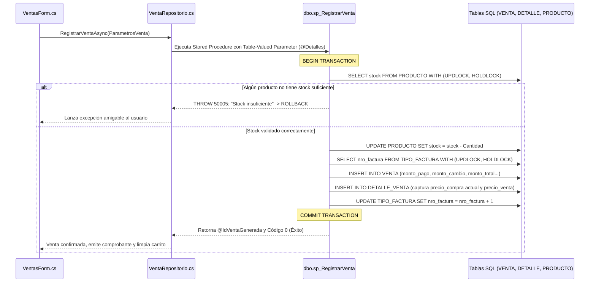

# 💳 Módulo 05: Ventas, Caja y Facturación (POS)

## Resumen Ejecutivo
Implementa el punto de venta (POS) para cobro y facturación de productos, garantizando consistencia transaccional ACID en el inventario mediante Stored Procedures con bloqueos pesimistas, y soporte de anulación con restitución automática de stock.

---

## 1. Puntos Clave para la Defensa

| Concepto | Implementación Técnica | Ubicación en Código |
|---|---|---|
| **Consistencia Transaccional (ACID)** | Todo el registro ocurre dentro de `dbo.sp_RegistrarVenta` en una única transacción de SQL Server con `XACT_ABORT ON`. | [scripts/sp_RegistrarVenta.sql](file:///home/nestorgariglio/repositories/university/proyecto_taller_programacion_2/scripts/sp_RegistrarVenta.sql) |
| **Prevención de Venta sin Stock** | Bloqueo pesimista con hints `WITH (UPDLOCK, HOLDLOCK)` sobre `dbo.PRODUCTO` durante la verificación y descuento. | [scripts/sp_RegistrarVenta.sql](file:///home/nestorgariglio/repositories/university/proyecto_taller_programacion_2/scripts/sp_RegistrarVenta.sql) |
| **Comprobantes y Numeración** | Tabla `TIPO_FACTURA` (Factura 'B'). Genera comprobantes correlativos con formato `B-00000001`. | [CapaEntidad/TipoFactura.cs](file:///home/nestorgariglio/repositories/university/proyecto_taller_programacion_2/CapaEntidad/TipoFactura.cs) |
| **Cobro y Cambio** | Validación en frontend y en SP: `monto_pago >= monto_total`. Cálculo automático de vuelto: `monto_cambio = monto_pago - monto_total`. | [CapaPresentacion/Ventas/VentasForm.cs](file:///home/nestorgariglio/repositories/university/proyecto_taller_programacion_2/CapaPresentacion/Ventas/VentasForm.cs) |
| **Anulación de Ventas (HU-13)** | Solo usuarios autorizados (`Administrador` / `Encargado`). Exige motivo obligatorio, marca `estado = 0` y restituye el stock en `PRODUCTO`. | [CapaNegocio/VentaNegocio.cs](file:///home/nestorgariglio/repositories/university/proyecto_taller_programacion_2/CapaNegocio/VentaNegocio.cs) |

---

## 2. Flujo de Ejecución de `dbo.sp_RegistrarVenta`



---

## 3. Preservación del Costo Histórico en `DETALLE_VENTA`

Una decisión arquitectónica fundamental:
```sql
INSERT INTO dbo.DETALLE_VENTA (id_venta, id_producto, precio_compra, precio_venta, cantidad, subtotal)
SELECT @IdVentaGenerada, d.IdProducto, p.precio_compra, d.PrecioVenta, d.Cantidad, d.Subtotal
FROM @Detalles d
INNER JOIN dbo.PRODUCTO p ON p.id_producto = d.IdProducto;
```
Al copiar `p.precio_compra` en la fila del detalle de venta, el sistema “congela” cuánto le costó a la empresa esa mercadería en ese momento exacto. Esto permite calcular las ganancias reales en el módulo de reportes sin que los aumentos de precios futuros alteren el balance contable del pasado.

---

## 4. Preguntas Frecuentes de Examen

- **¿Qué pasa si el sistema se apaga justo mientras se guardan los productos de una venta?**:  
  Gracias a la transacción en SQL Server (`BEGIN TRANSACTION` y `XACT_ABORT ON`), la operación es atómica: o se descuenta el stock, se genera la venta y se insertan todos los renglones, o no se guarda absolutamente nada. No pueden quedar estados inconsistentes.
- **¿Cómo se anula una venta?**:  
  Desde el botón "Historial" en la pantalla de ventas, se selecciona la transacción y se presiona "Anular Venta". Se solicita confirmación y motivo de anulación. El servicio `VentaNegocio.AnularVentaAsync` ejecuta la reversión aumentando el stock de cada producto involucrado y registrando `fecha_anulacion`, `id_usuario_anula` y `motivo_anulacion`.
