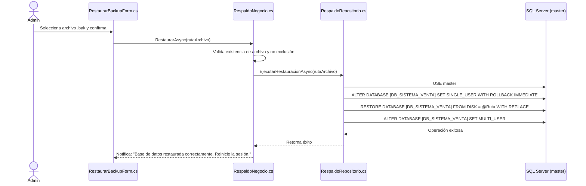

# 💾 Módulo 07: Respaldo y Restauración de Base de Datos

## Resumen Ejecutivo
Permite al Administrador del sistema realizar copias de seguridad completas (.bak) y restaurar la base de datos en caso de contingencia o desastre, cumpliendo con las mejores prácticas de administración de SQL Server.

---

## 1. Puntos Clave para la Defensa

| Concepto | Implementación Técnica | Ubicación en Código |
|---|---|---|
| **Acceso Exclusivo** | Solo disponible para el rol `Administrador`. Oculto para `Encargado` y `Vendedor`. | [CapaNegocio/PoliticaAcceso.cs](file:///home/nestorgariglio/repositories/university/proyecto_taller_programacion_2/CapaNegocio/PoliticaAcceso.cs) |
| **Generación de Backup** | Ejecuta comando nativo `BACKUP DATABASE [DB_SISTEMA_VENTA] TO DISK = @Ruta WITH INIT`. | [CapaDatos/Respaldo/RespaldoRepositorio.cs](file:///home/nestorgariglio/repositories/university/proyecto_taller_programacion_2/CapaDatos/Respaldo/RespaldoRepositorio.cs) |
| **Restauración Segura** | 1) Pasa la base a `SINGLE_USER WITH ROLLBACK IMMEDIATE` para cortar conexiones activas.  2) Ejecuta `RESTORE DATABASE ... WITH REPLACE`.  3) Vuelve a `MULTI_USER`. | [CapaDatos/Respaldo/RespaldoRepositorio.cs](file:///home/nestorgariglio/repositories/university/proyecto_taller_programacion_2/CapaDatos/Respaldo/RespaldoRepositorio.cs) |
| **Protección contra Inyección / Bases del Sistema** | Componente `ExclusionRespaldo` impide operar o sobrescribir `master`, `tempdb`, `model` o `msdb`. | [CapaNegocio/Respaldo/ExclusionRespaldo.cs](file:///home/nestorgariglio/repositories/university/proyecto_taller_programacion_2/CapaNegocio/Respaldo/ExclusionRespaldo.cs) |
| **Ruta Configurable** | Lee `Respaldos:RutaCarpeta` desde `appsettings.json`, con fallback automático si no está definida. | [CapaDatos/Respaldo/ProveedorRutaRespaldo.cs](file:///home/nestorgariglio/repositories/university/proyecto_taller_programacion_2/CapaDatos/Respaldo/ProveedorRutaRespaldo.cs) |

---

## 2. Flujo de Restauración Crítica

---

## 3. ¿Por qué es necesario `SINGLE_USER WITH ROLLBACK IMMEDIATE`?

En SQL Server, si hay una sola aplicación, proceso o conexión activa abierta contra `DB_SISTEMA_VENTA`, el comando `RESTORE DATABASE` falla con el error:
> *"No se puede obtener acceso exclusivo a la base de datos porque está en uso"*.

Pasar la base a `SINGLE_USER WITH ROLLBACK IMMEDIATE` desconecta forzosamente cualquier cliente conectado y aborta transacciones abiertas no confirmadas, permitiendo que la restauración tome el control exclusivo del archivo `.mdf` y `.ldf`. Al finalizar, se devuelve inmediatamente a `MULTI_USER`.

---

## 4. Preguntas Frecuentes de Examen

- **¿Dónde se guardan los archivos de backup?**:  
  En la carpeta configurada en `appsettings.json` bajo la clave `Respaldos:RutaCarpeta`. Si no se especifica, se utiliza la carpeta de respaldos predeterminada de SQL Server o una subcarpeta segura en el directorio de la aplicación.
- **¿Por qué la restauración se conecta a la base `master`?**:  
  Porque no podés restaurar una base de datos mientras tu propia sesión está parada dentro de ella (`USE DB_SISTEMA_VENTA`). La conexión debe realizarse al catálogo `master`.
